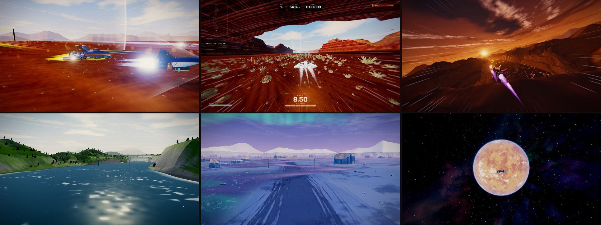
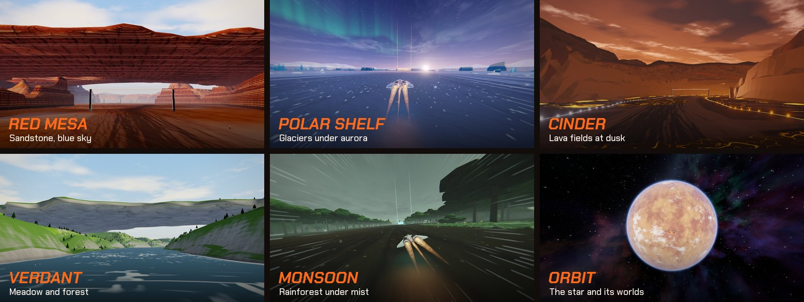

<h1 align="center">The Distance Between Us</h1>

<p align="center">A hover racer at Mach speed, in your browser.<br>Twenty courses across five worlds, dogfights in open sky, and a craft that can climb all the way to orbit.</p>

<p align="center"><a href="https://distance-between-us.keshav-madhav.com"></a></p>

https://github.com/user-attachments/assets/88be3dab-0a17-46f3-a0e1-52aee51fa2ec

<p align="center"><a href="https://distance-between-us.keshav-madhav.com">distance-between-us.keshav-madhav.com</a> · best on a computer, with a keyboard or a gamepad</p>

<p align="center"></p>

Games never feel fast enough, so this one is built around speed: Mach 9 a few metres off the ground, gates whipping
past, canyon walls close enough to touch. Then it opens up. Leave the track and take off, climb until the air runs
out, and keep going: the star system is out there, and you can fly down to any of its five worlds.

## Modes

| Mode | What it is |
|---|---|
| **Race** | 20 courses across five worlds. Race the field, run a **Time Trial** against the ghost of your best, or **Duel** one rival. Rivals go from Easy to Impossible; a Duel at Impossible races ROGUE, the no-rules optimal run. Medals are set against each course's IDEAL time: the fastest run a human could actually input. |
| **Hunt** | Combat in open sky, six waves of it. The craft truly flies: loops, dives, inverted. |
| **Free Roam** | The whole world and nothing to win. Take off at speed, touch down anywhere and drive on, chase trails of crystals across the summits and the sky. Climb past the air and you're among the worlds: point the nose at one, cruise there, and come down to its ground. |

Turn on the **racing line** to see the ideal line drawn on the ground, race your **ghost**, or load a run from a file
and watch it back. Every course has its own soundtrack.

## Worlds

<p align="center"></p>

| World | |
|---|---|
| **Red Mesa** | Sandstone, blue sky: the long drag, canyon runs under rock arches, a dry river full of jumps |
| **Polar Shelf** | Glaciers under aurora: frozen lakes, a lamplit cave inside a glacier |
| **Cinder** | Lava fields at dusk: basalt canyons, lava rivers, black glass |
| **Verdant** | Meadow and forest: river gorges, granite domes, the old forest |
| **Monsoon** | Rainforest under mist: karst towers, river crossings, under the canopy |

## Your craft

Six hulls (VANGUARD, BULWARK, LANCE, ARROW, BRUTE, NEEDLE), each painted your way: body and trim colours, seven
liveries, five finishes (gloss, matte, metallic, chrome, pearl) and five flame colours.

## Controls

| | Keyboard | Gamepad |
|---|---|---|
| Thrust | W or ↑ | RT |
| Afterburner | Shift | X |
| Steer | A / D or ← / → | left stick |
| Strafe | Q / E | right stick |
| Brake | S or ↓ | LT |
| Back to the last gate | R | |
| Restart | Shift + R | |
| Pause and settings | Esc | |

**In the air** (Hunt and Free Roam), the same keys fly the craft: A / D turn, Space pulls up, C pushes down, Q / E
roll, W, S and Shift for thrust, brake and afterburner. In Hunt, J or the mouse fires (A or RB on a gamepad).

## Build it

```
npm install
npm run dev        # http://localhost:5417
npm run build      # type-check, then build into dist/
npm run preview    # the build, on http://localhost:4417
```

three.js and TypeScript on Vite, with no game engine. The terrain, ships, scatter and sound effects are all made in
code, mostly in web workers. Design notes live in `docs/`.

### Regenerating textures (paid: Gemini)

Put `GEMINI_API_KEY=...` in `.env` (gitignored, never bundled). Then run
`node tools/generate-asset.mjs <name> <preset> <aspect> <size> "<request>"` (the prompts are in each
`assets/raw/*.json`), followed by `node tools/process-textures.mjs`.

## Credits

Music: CC0 tracks from OpenGameArt by MintoDog, Zane Little Music and cynicmusic. Sound effects from OpenGameArt by
dklon and Michel Baradari (CC-BY 3.0), SketchMan3 and pyranostudios (CC0); everything else is synthesised in the
browser. Ground textures and key art generated with Google Gemini. Font: Chakra Petch (SIL Open Font License).
Full list in [CREDITS.md](CREDITS.md).
